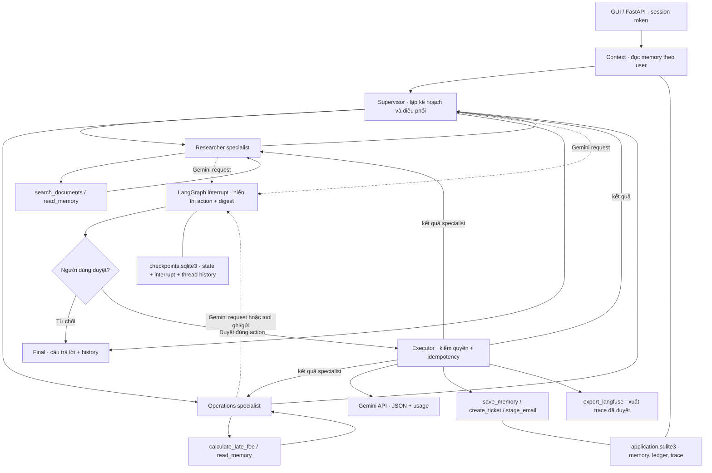

# Multi-agent Library — kiến trúc

Hệ này tái sử dụng 7 tài liệu Thư viện Bình Minh từ `RAG_library_demo.ipynb`. Đây là ứng dụng mới, không sửa notebook cũ. Supervisor điều phối hai specialist trong LangGraph. Các intent và quyền tool được giới hạn để dễ demo và kiểm tra.

**Vai trò và tool**

| Thành phần | Nhiệm vụ | Quyền |
|---|---|---|
| Supervisor | Chọn specialist và thứ tự, quay lại sau mỗi tác vụ | Không gọi tool ghi |
| Researcher | Tra cứu và trả lời có nguồn | `search_documents`, `read_memory` |
| Operations | Phí quá hạn, memory, ticket, outbox, xuất trace | `calculate_late_fee`, `read_memory`; các tool ghi/gửi phải qua gate |

Tổng cộng **7 tool**: `search_documents`, `read_memory`, `calculate_late_fee`, `save_memory`, `create_ticket`, `stage_email`, `export_langfuse`. `gemini_generate` là hành động gửi model riêng, cũng phải duyệt. Tool ở đây là các hàm Python được dispatcher kiểm quyền; chưa triển khai MCP server.

**Hai chế độ**

- **Gemini:** supervisor lập kế hoạch JSON; researcher sinh câu trả lời từ nguồn; operations giải thích tác vụ. Mỗi vai trò có prompt riêng, dùng cùng model Gemini. LLM không tự cấp quyền hoặc sửa tham số tool do người dùng nhập. Đây là multi-agent có luồng và quyền được giới hạn, không phải nhóm agent tự do làm mọi tác vụ.
- **Offline:** cùng graph/checkpoint/tools/approval, nhưng route do code chọn và researcher trả trích đoạn. Dùng để kiểm thử orchestration khi chưa có key. Không coi output này là câu trả lời sinh bởi LLM.

`research_ticket` đi qua cả researcher và operations trong cùng lượt. Các lượt hỏi đơn giản chỉ gọi specialist cần thiết. Cách làm này theo hướng ưu tiên thành phần đơn giản, đo được và có điểm dừng trong [Building effective agents](https://www.anthropic.com/engineering/building-effective-agents).

**Memory và checkpoint**

- Long-term memory nằm trong bảng `memories`, khóa `(user_id, key)`, dùng được qua nhiều thread và restart. Chỉ được ghi sau approval.
- Short-term history giữ tối đa 12 lượt trong checkpoint; câu hỏi tiếp “Còn thứ Bảy?” kết hợp câu hỏi trước để retrieval.
- `SqliteSaver` của LangGraph lưu node state và interrupt theo `thread_id`. Restart không tự chấp thuận hành động đang chờ.
- Mỗi thread được kiểm tra chủ sở hữu từ bearer token. Không tin `user_id` do model hoặc payload tự khai báo.

Tham khảo [LangGraph memory](https://docs.langchain.com/oss/python/langgraph/add-memory) và [interrupt/resume](https://docs.langchain.com/oss/python/langgraph/interrupts).

**Approval và side effect**

Trước mỗi tool ghi, mỗi lần gửi Gemini và mỗi lần xuất Langfuse, graph dừng bằng `interrupt()`. GUI hiển thị đích, nội dung, action ID và SHA-256 digest. API duyệt kiểm tra actor, thread, ID và digest. Không có autoapprove từ model.

Sau khi resume, executor kiểm lại digest và quyền tool. Memory/ticket/outbox cùng idempotency ledger commit trong một transaction. External request được reserve trước; nếu crash lúc chưa rõ kết quả thì không tự gửi lại. Không hứa exactly-once qua mạng. SQLite, checkpoint, session và trace log nội bộ là hoạt động hạ tầng của ứng dụng; gate áp dụng cho tác vụ ghi/gửi do agent thực hiện.

`stage_email` chỉ ghi bản nháp vào SQLite, **không gửi email thật**. Không có shell tool, tool SQL tùy ý hoặc quyền gửi đến địa chỉ bất kỳ. Output GUI dùng `textContent`; truy vấn DB dùng bind tham số.

**Tracing và cost**

Trace local ghi node, tool, approval, timestamp và usage vào SQLite; API tải JSONL. Langfuse SDK chỉ được khởi tạo để gửi sau khi xuất trace được duyệt. Chưa có Langfuse credentials nên bằng chứng hiện tại là local trace; SDK được kiểm tra với in-memory exporter, không phải dashboard cloud.

Xuất Langfuse là replay trace sau khi chạy, dùng metadata timestamp gốc; timeline span trên dashboard là thời điểm export. Không gọi đó là live tracing đã được xác minh. [Langfuse docs](https://langfuse.com/docs).

Gemini cost lấy từ usage metadata, tính input + output + thinking theo rate cấu hình. Có rate snapshot tham khảo trong `.env.example`; không phải hóa đơn. Lỗi thiếu usage cho cost `null`. [Gemini pricing](https://ai.google.dev/gemini-api/docs/pricing).

**Giới hạn**

Đây là demo local, một worker, khóa đồng bộ đơn giản và SQLite. Không dùng thay hệ auth/DB/queue production. Corpus giả rất nhỏ; lexical retrieval chưa tối ưu cho câu không dấu, đồng nghĩa hoặc câu hỏi phức tạp. Citation hợp lệ không chứng minh nội dung đúng. Gate và phân quyền giảm side effect, không bảo đảm model miễn nhiễm prompt injection.

[MCP](https://modelcontextprotocol.io/) là chuẩn kết nối tool/dữ liệu, không thay cơ chế phân quyền. Project này chưa dùng CrewAI, AutoGen hoặc OpenAI Agents SDK; LangGraph là framework điều phối.
