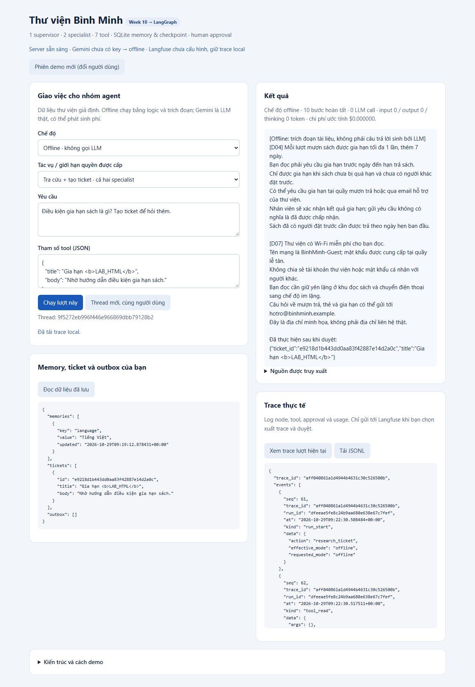

# Bằng chứng kiểm tra

Kiểm tra ngày **2026-10-29**. Xem số đo và giới hạn trong `EVAL_REPORT.md`.

| Phần | Kết quả | Bằng chứng |
|---|---|---|
| Bộ hồi quy offline | 25/25 scenario; trung bình 6,16 node hoàn tất/scenario; 0 model token; token cost 0 USD | `EVAL_REPORT.md`, `artifacts/evals/20261029T092024_535713Z/` |
| Kiểm tra hệ thống | 26 assertion qua kiểm tra | `artifacts/SYSTEM_CHECKS.json` |
| HTTP thật | 23 request kiểm tra; có dừng và bật lại process | `artifacts/HTTP_CHECKS.json`, `artifacts/http_server.log` |
| Compound qua API thật | Supervisor + researcher + operations; approval trước ticket | `artifacts/actual_http_trace.jsonl` |
| GUI thật trong trình duyệt | Hỏi tài liệu, từ chối memory không ghi, duyệt memory rồi đọc ở thread mới, compound có nguồn D04, xem trace/inventory | `artifacts/gui_verified.jpg` |
| HTML handling | Tiêu đề chứa `<b>LAB_HTML</b>` xuất hiện như chuỗi literal trong câu trả lời; không tạo thẻ `b` trong answer | Quan sát DOM qua trình duyệt: `literalHTML=true`, `renderedTags=0`; ảnh GUI |
| Gemini SDK adapter | Một HTTP request giả lập bằng MockTransport, structured JSON config và usage/thinking token đúng | `verify_system.py`; chưa gọi Gemini thật |
| Langfuse SDK | SDK thật với in-memory exporter; không dùng dashboard cloud làm bằng chứng | `verify_system.py`; chưa upload trace thật |

Các lượt test và tương tác GUI dùng dữ liệu giả, không gửi email thật. Quyết định duyệt trong test tự động và thao tác GUI của người kiểm tra là mô phỏng thao tác người dùng; ứng dụng không tự duyệt từ output model.

Không có kết quả eval Gemini thật hoặc Langfuse Cloud do chưa có key/project. Project đã có điểm tích hợp, hướng dẫn cấu hình và gate trước khi gửi. Success rate offline chỉ đánh giá luồng cùng các điều kiện hồi quy nhỏ đã dùng khi phát triển, không chứng minh chất lượng LLM hoặc mức an toàn tổng quát.
