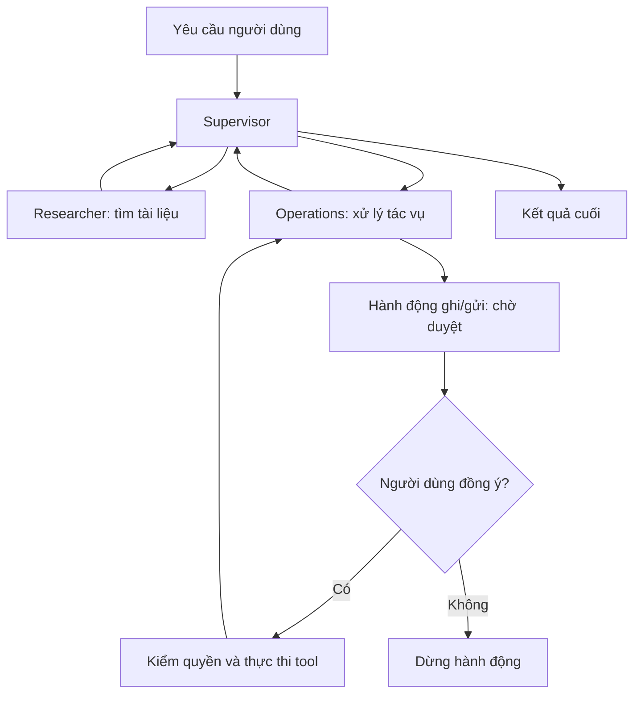

# Multi-agent với LangGraph, memory và human-in-the-loop

**Từ RAG sang multi-agent**

Ở bài RAG trước, mình gửi câu hỏi, tìm các đoạn tài liệu liên quan rồi dùng model để trả lời. Khi có thêm tác vụ như tính phí, lưu ghi nhớ hoặc tạo yêu cầu hỗ trợ, mình cần quản lý nhiều bước hơn.

Multi-agent là cách chia công việc cho nhiều agent có vai trò riêng. Một agent có thể chuyên tra cứu, agent khác chuyên xử lý tác vụ. Các agent không bắt buộc dùng những model khác nhau; chúng có thể dùng cùng một model nhưng khác prompt, tool và quyền.

Điều mình cần nhớ là nhiều agent không tự bảo đảm kết quả tốt hơn. Hệ có thể tốn thêm token, thời gian và khó debug hơn. Mình nên bắt đầu từ cách đơn giản, chỉ tăng độ phức tạp khi có lý do. Đây là điểm mình rút ra từ [Anthropic — Building effective agents](https://www.anthropic.com/engineering/building-effective-agents).

**Supervisor và specialist**

Trong demo thư viện, mình có 1 supervisor và 2 specialist:

| Agent | Vai trò |
| --- | --- |
| Supervisor | Chọn specialist, sắp xếp công việc và quyết định khi nào kết thúc |
| Researcher | Tra cứu tài liệu, trả lời câu hỏi và đưa nguồn |
| Operations | Tính phí, đọc/lưu memory, tạo ticket hoặc bản nháp email |

Ví dụ, câu hỏi về giờ mở cửa chỉ cần Researcher. Yêu cầu “Tra cứu điều kiện gia hạn rồi tạo ticket hỏi thêm” cần cả Researcher và Operations.

Mình không cần gọi tất cả agent trong mọi lượt. Supervisor nên giao đúng phần việc cần thiết và có điều kiện dừng rõ ràng.

**LangGraph dùng để làm gì?**

LangGraph giúp mình biểu diễn quá trình xử lý thành một graph có trạng thái. Mình có thể kết hợp bước viết bằng code với bước do LLM quyết định. Nó hỗ trợ các luồng cần lưu trạng thái, tạm dừng và tiếp tục. Xem [LangGraph overview](https://docs.langchain.com/oss/python/langgraph/overview).

Một số khái niệm mình cần phân biệt:

- **State:** dữ liệu đang dùng, như câu hỏi, lịch sử, nguồn, kết quả và hành động chờ duyệt.
- **Node:** một bước xử lý, có thể là agent, hàm đọc dữ liệu hoặc bước duyệt.
- **Edge:** đường chuyển từ node này sang node khác.
- **Conditional edge:** chọn bước tiếp theo dựa trên state.

Node không nhất thiết là một LLM call. Trong demo, có node chỉ đọc memory, kiểm tra approval hoặc ghép kết quả.

**Luồng xử lý mình hình dung**



Đây là sơ đồ rút gọn. Trong demo, các lần gửi dữ liệu sang Gemini hoặc xuất trace sang Langfuse cũng phải qua bước duyệt. Sơ đồ đầy đủ nằm trong [architecture của project](<D:/Sudo code 2026/week10_multiagent_demo/ARCHITECTURE.md>).

**Tool và quyền của agent**

Tool là hàm để agent làm việc với dữ liệu hoặc thực hiện một tác vụ cụ thể. Model có thể đề xuất hành động; code mới là nơi kiểm tra và thực thi.

Demo của mình có 7 tool, đáp ứng yêu cầu tối thiểu 3 tool:

| Tool | Chức năng | Có cần duyệt trong demo? |
| --- | --- | --- |
| `search_documents` | Tìm tài liệu trong kho thư viện | Không, nhưng phải đúng quyền đọc |
| `read_memory` | Đọc ghi nhớ của người dùng hiện tại | Không, nhưng phải đúng người dùng |
| `calculate_late_fee` | Tính phí quá hạn theo quy định giả định | Không |
| `save_memory` | Lưu ghi nhớ lâu dài | Có |
| `create_ticket` | Tạo ticket hỗ trợ local | Có |
| `stage_email` | Lưu email vào outbox local | Có; chưa gửi email thật |
| `export_langfuse` | Gửi trace đã chọn sang Langfuse | Có |

Researcher không được gọi tool ghi. Operations cũng không được tự bỏ qua approval. Việc chia vai trò cần đi kèm kiểm quyền ở code; chỉ ghi trong prompt rằng agent “không được làm” là chưa đủ.

**Memory và checkpoint khác nhau thế nào?**

| Thành phần | Mình dùng để nhớ gì? | Ví dụ |
| --- | --- | --- |
| Short-term memory | Ngữ cảnh trong một cuộc hội thoại | Câu “Còn thứ Bảy?” đang hỏi tiếp về giờ mở cửa |
| Long-term memory | Thông tin cần dùng qua nhiều cuộc hội thoại | Người dùng thích câu trả lời bằng tiếng Việt |
| Checkpoint | Trạng thái xử lý của graph tại các điểm thực thi | Agent đang dừng trước thao tác lưu memory |

Checkpoint có thể lưu cả lịch sử hội thoại trong state, nhưng không tự biến dữ liệu đó thành long-term memory dùng xuyên mọi thread. Mình phải thiết kế cách lưu và tìm lại thông tin lâu dài. Tham khảo [LangGraph memory](https://docs.langchain.com/oss/python/langgraph/add-memory).

Trong project, long-term memory nằm ở SQLite, theo khóa người dùng và tên ghi nhớ. Checkpoint dùng `SqliteSaver`, gắn với `thread_id`. Tạo thread mới thì lịch sử hội thoại mới bắt đầu, còn memory của cùng người dùng vẫn có thể được đọc.

Memory không có nghĩa model đã được train lại. Đây là dữ liệu được ứng dụng lưu và đưa vào ngữ cảnh khi cần. Mình cũng phải tránh để memory của người này xuất hiện trong câu trả lời cho người khác.

**Chạy qua nhiều lượt và tiếp tục sau khi dừng**

Để hỏi tiếp trong cùng cuộc hội thoại, mình dùng lại thread tương ứng. Nếu muốn khôi phục sau khi restart server, state phải được lưu bền vững, không chỉ giữ trong biến Python.

Ví dụ, người dùng yêu cầu lưu một sở thích. Graph dừng ở approval, server được khởi động lại, sau đó người dùng vẫn có thể xem và duyệt đúng hành động đang chờ. Restart không có nghĩa hành động tự được chấp thuận.

LangGraph hỗ trợ dừng bằng `interrupt()` và tiếp tục bằng `Command(resume=...)` với thread tương ứng. Khi resume, node chứa interrupt có thể chạy lại từ đầu, nên mình cần tránh đặt thao tác ghi/gửi trước điểm dừng. Xem [LangGraph interrupts](https://docs.langchain.com/oss/python/langgraph/interrupts).

**Human-in-the-loop approval**

Human-in-the-loop nghĩa là có bước con người tham gia vào quá trình xử lý. Trong bài này, mình dùng nó để duyệt trước hành động ghi dữ liệu hoặc gửi ra ngoài.

Luồng mình cần giữ:

```text
Đề xuất hành động → Hiển thị tool, đích và nội dung → Người dùng duyệt
→ Kiểm tra lại quyền và tham số → Thực thi → Ghi kết quả
```

Approval phải gắn với đúng hành động. Nếu nội dung ticket hoặc đích gửi thay đổi sau khi duyệt thì không được dùng lại lần duyệt cũ. Demo dùng action ID và digest để kiểm tra điều này.

Nếu người dùng từ chối thì tác vụ đang chờ không được ghi/gửi. Lời model nói “đã được đồng ý” cũng không thay thế quyết định của người dùng.

Trong demo, gate áp dụng cho các tác vụ của agent, kể cả ghi memory và gửi Gemini. Việc ứng dụng tự lưu checkpoint, session và log local là hoạt động hạ tầng để giữ trạng thái.

**Tracing giúp mình hiểu chuyện gì đã xảy ra**

Nhìn câu trả lời cuối chưa đủ để biết hệ chạy đúng. Mình cần biết supervisor chọn ai, tool nào được gọi, agent đọc nguồn gì, có chờ duyệt không và bao nhiêu token đã được dùng.

Trace là bản ghi của một lượt xử lý và các bước bên trong nó. Nó giúp mình tìm bước gây lỗi hoặc tốn nhiều thời gian. [Langfuse](https://langfuse.com/docs) hỗ trợ quan sát LLM call và các bước như retrieval/tool; [LangSmith](https://docs.langchain.com/langsmith/observability) cũng hỗ trợ theo dõi và phân tích hệ LLM.

Trong demo hiện tại, trace thực tế được lưu local và tải thành JSONL. Mình đã chuẩn bị tích hợp Langfuse, nhưng chưa có project/key để xác nhận dữ liệu trên dashboard cloud. Xuất trace hiện là gửi lại log sau khi chạy, không phải live tracing đã được kiểm chứng.

Khi có key, mình cần xem dữ liệu và đích trước khi gửi trace. Không đưa API key hoặc dữ liệu không cần thiết vào log.

**Xây bộ eval ít nhất 20 case**

Eval giúp mình kiểm tra bằng một bộ tình huống có điều kiện thành công rõ ràng. Mình không chỉ thử vài câu thấy trả lời hợp lý rồi kết luận hệ hoạt động tốt.

Bộ hồi quy của demo hiện có 25 scenario:

| Nhóm | Số case |
| --- | ---: |
| Hỏi đáp có nguồn | 14 |
| Câu hỏi ngoài miền | 1 |
| Tính phí | 2 |
| Lưu memory: duyệt và từ chối | 2 |
| Ticket và outbox | 3 |
| Phối hợp hai specialist | 2 |
| Hỏi tiếp và khôi phục trạng thái | 1 |
| Tổng | 25 |

Với QA, mình kiểm tra nguồn mong đợi và thông tin cần có. Với tool ghi, mình kiểm tra dữ liệu trước/sau approval. Với memory, mình thử đọc lại ở thread mới. Trace giúp kiểm tra một lượt phối hợp có thật sự đi qua cả hai specialist không.

Mình cũng cần thử các trường hợp như người dùng khác truy cập thread, digest sai, duyệt lại hành động cũ và gửi thêm yêu cầu khi thread còn chờ duyệt.

**Success rate, số bước và chi phí token**

```text
Success rate = số scenario đạt điều kiện / tổng số scenario được đánh giá

Avg steps = tổng số bước của các scenario / số scenario

Avg token cost/run = tổng chi phí token của các scenario / số scenario
```

Mình cần định nghĩa “bước” trước khi đo. Trong demo, một bước là một node hoàn tất; không phải một token hay một LLM call. Số bước tính cả supervisor và bước duyệt sau khi resume. Một lần interrupt chưa hoàn tất không được tính như node đã xong.

Chi phí phải cộng các lần gọi model trong toàn bộ scenario, không chỉ câu trả lời cuối. Nếu provider tính phí thinking token thì phải đưa vào phần tương ứng. Token lấy từ usage metadata; chi phí ước tính dựa trên giá model đang cấu hình. Xem [Langfuse token and cost tracking](https://langfuse.com/docs/observability/features/token-and-cost-tracking).

Request lỗi vẫn có thể đã tiêu thụ token. Nếu chưa có đủ usage thì ghi chưa xác định, không tự gán chi phí bằng 0. Chi phí token cũng chưa bao gồm máy chủ, lưu trữ hoặc dịch vụ tracing.

**Kết quả mình đã có từ demo**

Theo [báo cáo eval](<D:/Sudo code 2026/week10_multiagent_demo/EVAL_REPORT.md>):

| Chế độ | Scenario đạt | Success rate | Bước trung bình/scenario | Token cost trung bình/scenario |
| --- | ---: | ---: | ---: | ---: |
| Offline | 25/25 | 100% | 6,16 | 0 USD |

Ở chế độ offline, graph, tool, checkpoint và approval chạy thật; phần chọn luồng dùng code và câu trả lời là trích đoạn tài liệu. Không có LLM call nên model token và token cost đều bằng 0.

Kết quả này chưa đánh giá chất lượng Gemini. Bộ case cũng đã được dùng trong quá trình phát triển, nên 100% trên bộ hồi quy không có nghĩa hệ trả lời đúng mọi câu hỏi hoặc an toàn trước mọi tấn công. Mình cần bộ đánh giá chưa dùng khi phát triển nếu muốn đo khả năng tổng quát hóa.

Project có [trace từ HTTP thực tế](<D:/Sudo code 2026/week10_multiagent_demo/artifacts/actual_http_trace.jsonl>) và [bằng chứng kiểm tra](<D:/Sudo code 2026/week10_multiagent_demo/VERIFICATION.md>). Khi chạy Gemini thật, mình phải đo lại success rate, bước, token và cost thay vì dùng số offline.

**MCP có vai trò gì?**

MCP là chuẩn để ứng dụng AI kết nối với tool và nguồn dữ liệu bên ngoài. Mình hiểu nó là một cách thống nhất giao tiếp, giúp việc tích hợp dễ hơn. Xem [Model Context Protocol](https://modelcontextprotocol.io/).

LangGraph quản lý luồng xử lý và trạng thái; MCP giúp kết nối công cụ/dữ liệu. Hai phần có thể kết hợp, nhưng MCP không tự quyết định agent được phép làm gì.

Demo hiện dùng tool Python trực tiếp, chưa dựng MCP server. Mình cũng chưa dùng CrewAI, AutoGen hoặc OpenAI Agents SDK trong project này; không cần ghép nhiều framework chỉ để có nhiều agent.

**Chuẩn bị output và demo 5 phút**

Mình cần có hệ chạy được qua GUI hoặc API, sơ đồ kiến trúc, trace của lần chạy thật và bảng eval. Trong phần trình bày, nên cho thấy cả trường hợp thành công lẫn trường hợp từ chối approval.

Kịch bản mình có thể dùng:

1. Giới thiệu supervisor, hai specialist và các tool.
2. Hỏi giờ mở cửa rồi hỏi tiếp để cho thấy ngữ cảnh nhiều lượt.
3. Thử lưu memory, từ chối rồi thử lại và duyệt.
4. Tạo thread mới để đọc memory; chạy một tác vụ cần cả hai specialist.
5. Mở trace và bảng eval, giải thích số bước, token cost và giới hạn.

Chi tiết nằm trong [kịch bản demo 5 phút](<D:/Sudo code 2026/week10_multiagent_demo/DEMO_5_MINUTES.md>). Phần này là kế hoạch trình diễn, không phải video đã quay. Cách cài và chạy nằm trong [README của project](<D:/Sudo code 2026/week10_multiagent_demo/README.md>).

**Điều mình cần nhớ**

Multi-agent có ích khi vai trò, công việc và quyền được chia rõ. Memory giúp giữ thông tin cần dùng, checkpoint giúp tiếp tục xử lý, còn approval giúp người dùng kiểm soát tác vụ ghi/gửi.

Mình cần dùng trace và eval để kiểm tra hành vi thực tế. Số agent nhiều hơn, câu trả lời tự nhiên hơn hoặc một bảng điểm cao trên bộ test nhỏ đều chưa đủ để chứng minh hệ tốt hơn.

**Tài liệu tham khảo**

- [LangGraph — đường dẫn ban đầu](https://langchain-ai.github.io/langgraph/) và [tài liệu hiện tại](https://docs.langchain.com/oss/python/langgraph/overview)
- [LangGraph memory](https://docs.langchain.com/oss/python/langgraph/add-memory)
- [LangGraph interrupts](https://docs.langchain.com/oss/python/langgraph/interrupts)
- [Anthropic — Building effective agents](https://www.anthropic.com/engineering/building-effective-agents)
- [Model Context Protocol](https://modelcontextprotocol.io/)
- [Langfuse](https://langfuse.com/docs)
- [LangSmith Observability](https://docs.langchain.com/langsmith/observability)
